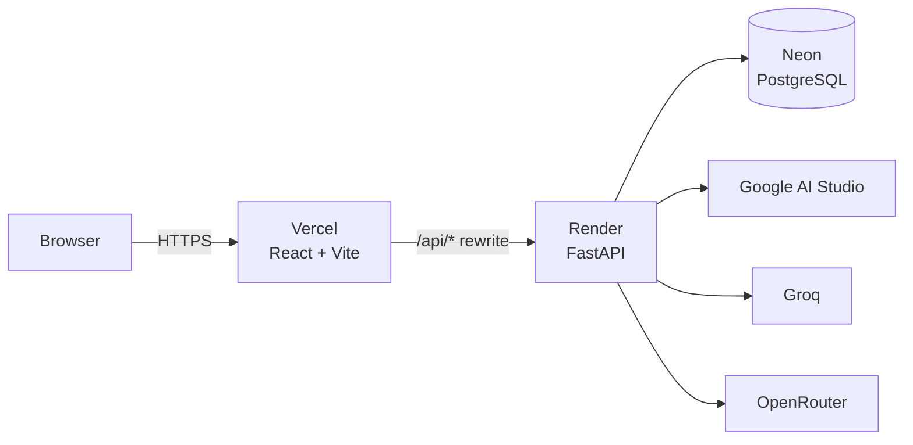
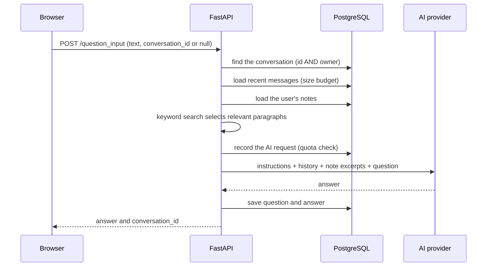
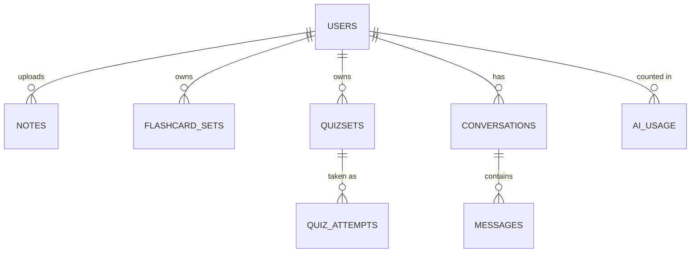

# ACE architecture

This document explains how ACE is put together and why. The diagrams use Mermaid, which GitHub renders automatically.

## System overview

- The browser only ever talks to the Vercel domain.
- Vercel serves the React app and forwards every `/api/*` request to the FastAPI service on Render (see `vercel.json`).
- FastAPI stores everything in PostgreSQL and calls an AI provider when it needs to generate text.

## Why the `/api` rewrite

The frontend and backend live on different domains. Login uses a cookie, and browsers such as Safari block cookies that are set by a different site. Forwarding `/api` through the frontend host makes every request look same-site, so the cookie works everywhere and no cross-origin (CORS) configuration is needed in production.

## Request lifecycle: asking a question

Key points:

- **A new chat has no id.** The server creates the conversation after the AI answers, so a failed AI call leaves nothing half-saved, and returns the new id. The browser sends that id with every later question.
- **The id is never trusted on its own.** Every lookup filters by the id and the logged-in user.
- **Saving is a bonus.** If the database write fails after the AI answered, the user still gets the answer.

## Data model

| Table | Holds |
|---|---|
| `users` | email, name, password hash |
| `notes` | extracted text of each uploaded file, per user |
| `flashcard_sets` | one row per generated set; the cards are stored as JSON |
| `quizsets` | one row per generated quiz; the questions are stored as JSON |
| `quiz_attempts` | one row per finished attempt: score, total, the picked answers (JSON) |
| `conversations` | one row per chat: title, owner, last-used time |
| `messages` | one row per message (`user` or `assistant`) |
| `ai_usage` | one row per AI request, used for daily quotas |

Design choices:

- **Chats use two tables, sets and quizzes use one.** A chat grows one message at a time and only part of it is needed per request, so each message is a row. A flashcard set or quiz is created once and read whole, so storing it as JSON in one row is simpler.
- **Attempts store the picked answers, not the results.** The questions already contain the correct answers, so a past attempt is reviewed by grading the saved picks again with the same code used after finishing a quiz.
- **Cascading deletes.** Deleting a user, a conversation or a quiz removes everything that belongs to it.

## Authentication

- A JWT with a 7-day lifetime is stored in a cookie.
- The signing secret comes from the `JWT_SECRET` environment variable, and the app refuses to start if it is shorter than 32 characters.
- Every protected route depends on one `get_current_user` function that returns the user id.
- The frontend asks `/auth/profile` to know whether someone is logged in, and re-checks it on every page change.

## Retrieval

Retrieval is keyword-based so it fits in a free 512 MB server:

1. Stop words are removed from the question.
2. Each note scores points for keyword matches, with filename matches counting far more than body matches.
3. The top three notes are chosen, and inside each one the paragraphs with the most keyword matches are selected, up to a size limit.
4. For very short follow-ups such as "explain that more simply", the keywords of the previous user question are added.

An earlier version used a local sentence-transformer model for semantic ranking. It was removed because the model plus PyTorch does not fit in the memory of a free host.

## Conversation memory

- Messages are stored in the database, never in server memory.
- On each question, the latest messages (up to 40) are loaded newest first, kept while their combined length stays under a size budget, then put back in order.
- If the first kept message is an answer whose question was cut off, it is dropped.
- Note excerpts are used for the current question only and are not saved in the history.
- The database has columns reserved for a rolling summary of old messages. That feature was designed but not built.

## AI provider layer

All providers speak the OpenAI-compatible chat API, so one client works for all of them. Providers are tried in order. A provider is skipped on any error or timeout, with short, per-provider timeouts and no automatic retries, so a slow provider cannot block the request for long. If every provider fails, the user gets a clear "busy" message and nothing is saved.

## Quotas

Free AI keys have limits, so ACE protects them:

- A small `ai_usage` table records every AI request (who, what kind, when).
- Before each AI call, a helper counts today's requests: first for everyone together, then for this user and this kind of request. Over the limit, the API answers 429 with a readable message.
- Limits live in one place and are easy to change.
- Requests are also bounded in size: a maximum number of cards or questions, a maximum topic length, a maximum amount of note text, and upload size limits.

## Frontend structure

- **Pages** hold state and talk to the API. **Components** only display what they are given.
- **The address bar is shared memory.** Which item is open is stored in the URL (`?set=`, `?quiz=`, `?attempt=`, `?conversation=`). The sidebar sets it by linking, and the page reads it and fetches the data. This works across separate components, survives a refresh, and makes the back button work.
- **Small announcements keep lists fresh.** After creating or deleting something, a page dispatches a browser event such as `quizzes-changed`, and the sidebar reloads its list.
- **The sidebar adapts to the page.** It shows recent chats on the chat page, quizzes on the quiz page, and flashcard sets elsewhere. On phones it becomes a slide-in drawer.
- **Themes** use CSS variables, and the chosen accent color is saved in the browser.

## Trade-offs and limitations

| Decision | Benefit | Cost |
|---|---|---|
| Keyword retrieval | Runs on a free host | Misses paraphrases |
| Quiz is graded from what the browser sends | Simple, one grading function | A determined user can fake a score |
| Correct answers sent with the quiz | Instant feedback | Visible in the browser's network tab |
| Daily quotas only | Easy to build and explain | No per-minute rate limiting |
| Free hosting | No cost | Cold starts, shared limits |

## Bugs that taught the most

- A chat history kept in one server-wide list was shared by every user.
- `extend` on a list of dictionaries added the dictionary keys, which produced invalid requests for the AI providers.
- SQLite accepted a text id where PostgreSQL required an integer.
- A foreign key pointing at the wrong table silently removed cascade deletes.
- PDFs with invisible NUL characters could not be stored in PostgreSQL.
- A secret in source code is a secret everyone can read.
